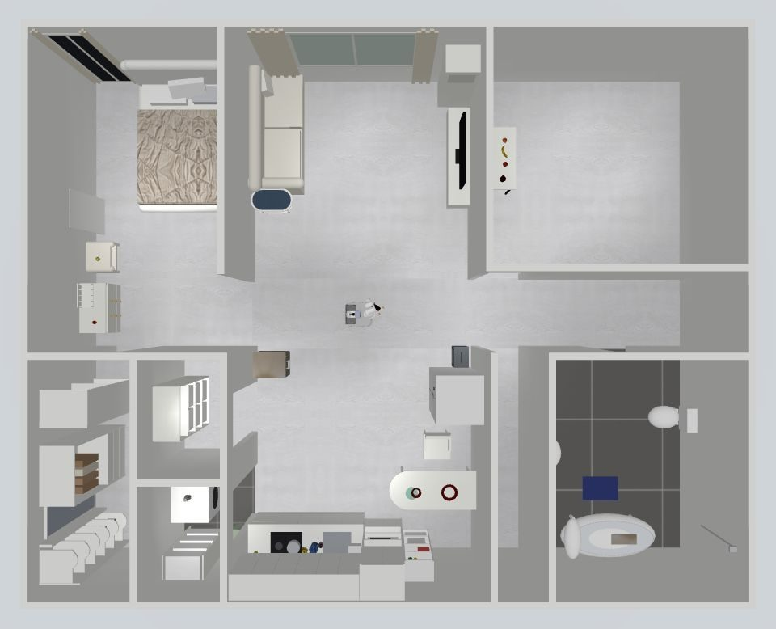

# Getting started

From an empty shell to the robot moving in the simulated house under `kcare_robot` control.
Every output below was recorded on the development machine (RTX A6000, 7 Oct 2026).

!!! warning "What is not in this repository"
    Two parts belong to the robot's maker and are not public: the robot's ROS 2 workspace (its
    URDF sources, the `kaair_msgs` message package, the base Docker image) and the `kcare_robot` /
    `robot_agent` application code. The robot model generated from the URDF (`sim/urdf`,
    `sim/mjcf`, `sim/assets`) **is** included, so the MuJoCo scenes, data generation and policy
    evaluation run without them; the ROS 2 bridge and the kcare integration need them.

## 1. Start the container

```bash
cd sim
make image          # kaair-moveit:humble (robot workspace Dockerfile) + kaair-sim:humble
make up             # container kaair_sim_humble, ROS_DOMAIN_ID=77, /sim = this directory
make shell
```

The image adds MuJoCo, trimesh, CoACD and EGL (headless rendering) to the robot's ROS 2 Humble
image ([`docker/Dockerfile.sim`](https://github.com/mtbui2010/kcare_sim/blob/main/sim/docker/Dockerfile.sim)).

## 2. Build the house

```bash
bash scripts/fetch_ycb.sh                     # the 16 scanned YCB objects (~200 MB, once)
python3 scripts/house_scene.py --render
```

```text
-> /sim/mjcf/house.xml   9 spots, 16 objects
-> /sim/out/house
```

`--render` also writes a top view, one view per room and the photo comparisons
(`out/house/photo_<room>.jpg`).

## 3. Create kcare's site profile for the house

```bash
python3 scripts/make_kcare_sim_location.py
```

```text
-> /sim/kcare_sim_configs/locations/sim_house: 35 connections, 11 ENV locations; active_location = sim_house
   desk@study room              loc (  3.10,   2.50) rz -180.0  height 0.72
   drawer@kitchen               loc ( -0.76,  -0.21) rz -178.1  height 0.583
   counter@kitchen              loc ( -0.80,  -2.76) rz  -90.0  height 0.9
   ...
```

Each place the robot can visit becomes an `ENV` entry (where to stand, which way to face, the
surface height) — the same format the real robot's sites use.

## 4. Start everything

```bash
bash scripts/run_house.sh start
bash scripts/run_house.sh status
```

```text
sim: running
vla node: running
kcare: running on :8001
```

Open the kcare dashboard on `:8001`: the camera grid shows the head and wrist cameras plus two
viewer cameras, `sim_overview` (follows the robot) and `sim_topdown` (the whole house).



## 5. Drive it

```bash
python3 scripts/house_tour_test.py
```

```text
| 0 | desk@study room | 25 OK | orange: found | 3 | 0.71 | 15.4 |
| 1 | shelf@kitchen | 26 OK | cracker box: found | 1 | 0.75 | 4.5 |
| 2 | counter@kitchen | 17 OK | mustard bottle: found | 1 | 0.52 | 12.7 |
| 3 | dining table@kitchen | 19 OK | bowl: NOT found | 2 | - | - |
| 4 | washer@laundry room | 16 OK | bleach bottle: found | 1 | 0.41 | 96.3 |
| 5 | chest@bedroom | 22 OK | red cup: found | 1 | 0.86 | 6.5 |
| 6 | stool@bedroom | 15 OK | tennis ball: found | 1 | 0.45 | 6.6 |
| 7 | shelf@restroom | 33 OK | spray bottle: found | 1 | 0.35 | 64.8 |
| - | home | 21 OK | | | | |
```

Columns: stop, place, seconds to get there, `find` result, seconds, detector score, distance
between the position kcare computed and the true one [cm]. This run shows the current state
honestly: two of the seven found objects were localised 65–96 cm off (the 3-D point landed on
the background), and the bowl was not detected.

!!! note "Common error"
    `navigate_to_pose: no path to (x, y)` in `out/house/bridge.log` while kcare's `move` still
    returns `isdone: true`: the planner cannot get through a doorway. kcare does not check the
    navigation result, so look at the bridge log. Doors narrower than 0.9 m, or a planner radius
    larger than the base (0.30 m), close them.

## Next

- [Run the house with kcare](guides/house-and-kcare.md) — the dashboard, cameras, recording videos
- [Generate open-drawer data](guides/open-drawer-data.md)
- [Train and evaluate a policy](guides/train-and-evaluate.md)
- [Run the VLA through kcare](guides/vla-through-kcare.md)
