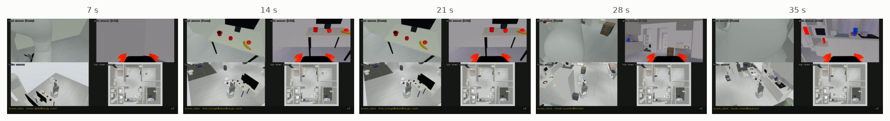

# Run the house with kcare

`run_house.sh` starts three processes in the container and keeps their logs in `out/house/`:

| process | what it is | log |
|---|---|---|
| sim bridge | MuJoCo house + the robot's ROS 2 interfaces ([`house_bridge.py`](https://github.com/mtbui2010/kcare_sim/blob/main/sim/scripts/house_bridge.py)) | `bridge.log` |
| VLA node | ROS action `/drawer/open` backed by vla-serve ([`vla_drawer_node.py`](https://github.com/mtbui2010/kcare_sim/blob/main/sim/scripts/vla_drawer_node.py)) | `vla_drawer.log` |
| kcare | the robot's `kcare_robot` FastAPI app on :8001, its code mounted read-only ([`kcare_sim_app.py`](https://github.com/mtbui2010/kcare_sim/blob/main/sim/scripts/kcare_sim_app.py)) | `kcare.log` |

```bash
bash scripts/run_house.sh start            # all three
bash scripts/run_house.sh restart-sim      # only the bridge (robot back at the start pose)
bash scripts/run_house.sh restart-kcare
bash scripts/run_house.sh stop
```

## Send skills

kcare's skills are HTTP calls; the dashboard sends the same ones.

```bash
curl -s -X POST localhost:8001/skill/move -H 'Content-Type: application/json' -d '{"inputs": "chest@bedroom"}'
curl -s -X POST localhost:8001/skill/find -H 'Content-Type: application/json' -d '{"inputs": "red cup@chest@bedroom"}'
```

Places (`desk@study room`, `counter@kitchen`, …) are the `ENV` entries written by
[`make_kcare_sim_location.py`](https://github.com/mtbui2010/kcare_sim/blob/main/sim/scripts/make_kcare_sim_location.py) from the spots in the
house layout.

## Cameras

| topic | what | rate |
|---|---|---|
| `/femto/color/image_raw` + `/femto/depth/aligned` | head camera, 1280×720, with the Femto camera model | ≈ 3.6 Hz with all four views rendering (A6000, a dataset job running) |
| `/hand/camera/color/image_raw/compressed` + `/hand/camera/depth/image_rect_raw` | wrist camera, 848×480, D405 model | same |
| `/sim/overview/image_raw/compressed` | follow camera, for people (not a robot sensor) | same |
| `/sim/topdown/image_raw/compressed` | fixed camera over the whole house, 960×778 | same |

## Record a camera-grid video

[`house_record_grid.py`](https://github.com/mtbui2010/kcare_sim/blob/main/sim/scripts/house_record_grid.py) records the four cameras as a 2×2 grid
while kcare runs a plan, and writes an overlay file (one event per command, the drawer opening
per frame) for narrated videos.

```bash
export ROS_DOMAIN_ID=77
python3 scripts/house_record_grid.py --speed 3 --out tour_grid \
  --plan 'move:desk@study room;find:orange@desk@study room;move:counter@kitchen;find:mustard bottle@counter@kitchen'
```

```text
-> /sim/out/house/tour_grid.mp4 630 frames max opened 0.0
```



!!! warning "Two clients, one robot"
    Two dashboards or scripts sending skills to the same robot at the same time interleave their
    motions. Use one client per robot.
