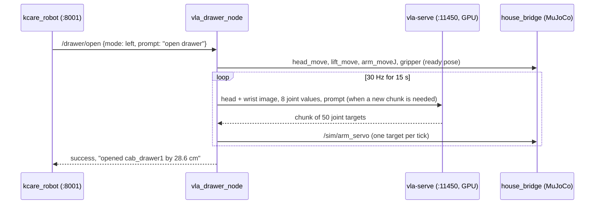

# Run the VLA through kcare

On the robot, kcare's `vla_drawer_open` skill sends `{mode, prompt}` to a ROS action
`/drawer/open`. In the simulation that action is served by
[`vla_drawer_node.py`](https://github.com/mtbui2010/kcare_sim/blob/main/sim/scripts/vla_drawer_node.py), which asks a
[vla-serve](https://mtbui2010.github.io/vla-serve/) server for actions.



## Steps

1. Serve a checkpoint (vla-serve's container):

    ```bash
    docker run -d --name vla-serve-kaair --gpus "device=3" -p 127.0.0.1:11450:11450 \
      -v /mnt/nas/lerobot_shared/kaair_sim/checkpoints:/ckpt:ro vla-serve:gpu-cu128 \
      serve --host 0.0.0.0 /ckpt/smolvla_open_drawer_officehouse_20261007/checkpoints/005000/pretrained_model
    ```

2. Restart the node so it picks the served model: `bash scripts/run_house.sh restart-vla`.
3. Drive to the cabinet and call the skill:

    ```bash
    curl -s -X POST localhost:8001/skill/move -H 'Content-Type: application/json' -d '{"inputs": "drawer@kitchen"}'
    curl -s -X POST localhost:8001/skill/vla_drawer_open -H 'Content-Type: application/json' -d '{"inputs": "open drawer"}'
    ```

Node log of the recorded run:

```text
[vla_drawer_node]: /drawer/open ready, policy /ckpt/smolvla_open_drawer_officehouse_20261007/checkpoints/005000/pretrained_model at http://127.0.0.1:11450
[vla_drawer_node]: opened cab_drawer1 by 28.6 cm (sim ground truth) in 18.7 s; {'steps': 450, 'stalls': 0, 'startup_ticks': 93, 'chunks': 14, ...}
```

`drawer@kitchen` puts the base exactly where the training put it relative to the cabinet
(`ROBOT_AT_DRAWER` in [`house_scene.py`](https://github.com/mtbui2010/kcare_sim/blob/main/sim/scripts/house_scene.py)); the policy only sees the
cabinet the way it was trained to.

!!! note "Success here is simulation ground truth"
    The node grades the result with `/sim/drawer_states`. On the real robot it would need its own
    check (depth or a VLM).
