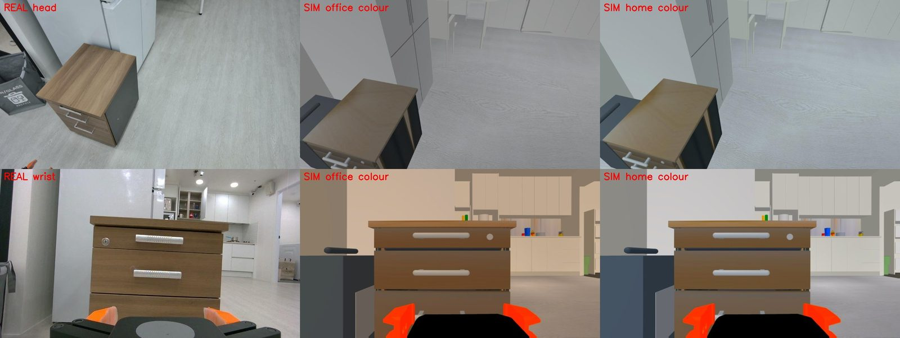

# Proving it is correct

From cheap to expensive. The bugs these checks caught are listed, because a check that never
fails proves little.

## 1. The robot model

[`check_sim.py`](https://github.com/mtbui2010/kcare_sim/blob/main/sim/scripts/check_sim.py) compares forward kinematics of the MuJoCo model with the
URDF on random joint sets, checks the robot holds a pose under gravity, steps stably and grasps an
object. Kinematics (joint origins, axes, limits) are never modified by the pipeline.

## 2. Cameras against the real robot

| check | data | result |
|---|---|---|
| colour of wood / white / floor, wrist camera | robot's own image at home vs sim at the same pose ([`calibrate_home.py`](https://github.com/mtbui2010/kcare_sim/blob/main/sim/scripts/calibrate_home.py)) | wood real (113, 89, 62) vs sim (108, 85, 59) |
| depth noise vs distance, D405 | the one real D405 depth frame (office) vs `DepthModel` ([`depth_compare.py`](https://github.com/mtbui2010/kcare_sim/blob/main/sim/scripts/depth_compare.py)) | 1.2 / 1.9 / 7.2 / 28 mm real vs 1.4 / 1.1 / 8.8 / 23 mm sim at 0.15 / 0.5 / 0.8 / 1.5 m |
| invalid depth pixels, D405 | same | 24 % real, 28 % sim |

## 3. The robot software in the house

[`house_tour_test.py`](https://github.com/mtbui2010/kcare_sim/blob/main/sim/scripts/house_tour_test.py) drives kcare to every place and checks the
3-D position `find` reports against the object's true position.

!!! measured "Measured (7 Oct 2026)"
    8/8 places reached; 7/8 objects found; errors 15.4, 4.5, 12.7, 96.3, 6.5, 6.6, 64.8 cm.
    The two large errors are open (the 3-D point lands on the background); see the
    [getting-started](../getting-started.md#5-drive-it) output.

## 4. Policies, closed loop

50 scenes from fixed seeds, the same camera model as the data, success = ≥ 20 cm within 15 s.

!!! measured "Measured (Sept 28 – Oct 7 2026, RTX A6000)"
    Office-trained policy in office scenes: 44/50 at 20k steps. In the house: 4/50. After 2.5k
    more steps on office + house data: 26/50 in the house.

## Bugs these checks caught

| symptom | found by | cause | fix |
|---|---|---|---|
| a second kcare action hung forever | first moves in the house | robot_agent's action client shared one result slot between goals | per-goal result slot (launcher patch) |
| `/skill/find` → HTTP 500 | dashboard | skill results contained numpy arrays | serialise results (launcher patch) |
| `find` errors of 2–7 m | tour test error column | the robot never reached the place: planner inflation closed 0.74–0.86 m doors, while kcare reported `move` OK | doors 0.9 m, planner radius 0.36 → 0.30 m (the base is 0.28 m) |
| white walls yellow in the wrist camera | comparison with the robot's home images | office colour gain fitted on one wood patch absorbed the wood's hue | white balance fitted on neutral surfaces, per site |
| grey blotches on the cabinet top | head-camera renders | cabinet sides and top shared a face (z-fighting) | sides stop under the top |
| office policy 8 % in the house | baseline eval | backgrounds never seen in training | house scenes in the training data |
