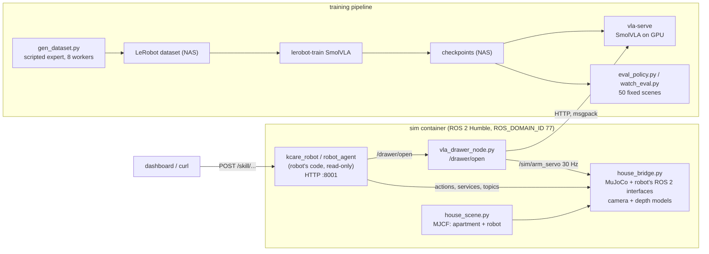

# How it works

For contributors: the pieces, one request end to end, and the decisions behind them.

## One skill call, end to end: `move::drawer@kitchen`

1. The dashboard posts `/skill/move` to kcare (`robot_agent` FastAPI, started by
   [`kcare_sim_app.py`](https://github.com/mtbui2010/kcare_sim/blob/main/sim/scripts/kcare_sim_app.py) with the `sim_house` site profile).
2. kcare looks up `drawer@kitchen` in its `ENV` (written by
   [`make_kcare_sim_location.py`](https://github.com/mtbui2010/kcare_sim/blob/main/sim/scripts/make_kcare_sim_location.py)) and sends a nav2
   `NavigateToPose` goal, then a final rotation (`/mobile/absolute_rotate`).
3. [`house_bridge.py`](https://github.com/mtbui2010/kcare_sim/blob/main/sim/scripts/house_bridge.py) plans A* on a 5 cm occupancy grid built from the
   house geometry (obstacles inflated by the 0.30 m base radius), shortens the path by line of sight
   and moves the mocap base along it in simulation time.
4. While it moves, the render thread publishes the head, wrist and viewer cameras through the
   camera and depth models; `/robot_pose/*` and `/joint_states` update kcare's view of the robot.
5. The action result goes back to kcare, which answers the HTTP call.

## Decisions, and why

| decision | why | rejected |
|---|---|---|
| Emulate the robot's ROS 2 interfaces instead of writing sim-specific skills | the robot's own `kcare_robot` code runs unchanged, so what works here exercises the real code path | a separate sim API (would test a different program) |
| Kinematic (mocap) base, simulated arm/lift/head/gripper | navigation is not what is being learned; manipulation needs real contact physics | wheel dynamics (slow, adds nothing to the drawer task) |
| Patch two robot_agent bugs in the launcher, not in its source | the robot's code is shared and read-only here; fixes are proposed upstream separately | editing the mounted source |
| Camera models fitted to the robot's images, per site | policies learn from pixels; an office fit tinted the home scenes yellow | one generic noise model |
| Render training scenes in the same house file the live sim uses | data, evaluation and the live demo see the same room | a separate training-only scene |
| Evaluate on 50 fixed seeds with Wilson intervals | changes are compared on identical scenes; noise is visible | "watch a few runs" |
| Policy served by vla-serve over HTTP | the same server and client the real robot uses | loading the policy inside the ROS node |
