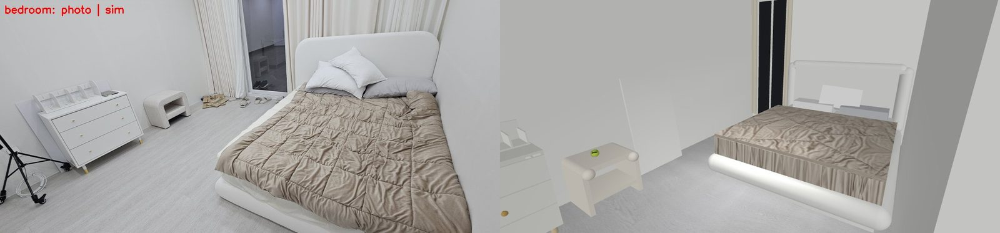

# 2. A scene from a floor plan and photos

!!! abstract "In this chapter"
    - A policy sees the room behind the object; train it in a room it will never see and it fails (8 %).
    - The house follows the owner's floor plan (drawio, 2 cm per unit) and photos; textures are cut from the photos.
    - Compare every room with a photo from the same viewpoint before trusting it.

## The idea

The office policy opened 88 % of drawers in office scenes and 8 % in the house: same cabinet,
same robot pose — only the room behind it differed. So the scene is part of the training data and
should look like the place the robot works. kcare-sim builds it from three sources:

1. **Floor plan** (`docs/draws/floor.drawio`): rooms, walls, doors and furniture positions;
   1 drawio unit = 2 cm, the apartment is 10 × 8 m.
2. **Photos**: furniture shapes and colours; textures (floor, wood, duvet, backsplash) cut from
   them with lighting flattened.
3. **The robot's own camera images**, which overrule photos: the phone photo suggested oak cabinet
   sides; the robot's head camera showed them dark grey.

!!! code "Where in the code"
    [`house_scene.py`](https://github.com/mtbui2010/kcare_sim/blob/main/sim/scripts/house_scene.py): `ROOMS`, `WALLS`, `furniture()`, `PHOTO_VIEWS`
    (the photo comparison cameras), `CAB_SITES` (the two places the cabinet can stand).

!!! measured "Measured"
    Policy trained in the office: 4/50 in the house. After adding house scenes: 26/50.

## What this means when you use it

- The cabinet stands in two places in the training data (the floor plan's spot and the one in the
  robot's photos), so the policy does not depend on one background.
- Doors in a floor plan sketch are often too narrow for the planner; 0.9 m works.
- Any change to what the cameras see from the cabinet means regenerating data.

**Next:** [3. Making renders look like the cameras →](03-camera-model.md)
