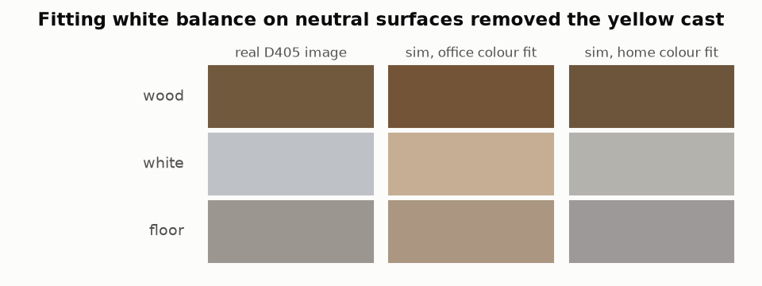

# 3. Making renders look like the cameras

!!! abstract "In this chapter"
    - A renderer produces an ideal pinhole image; a camera adds distortion, exposure, white balance, saturation, noise, compression and blur.
    - Each step is a few lines; the parameters are fitted to the robot's own images.
    - Fit white balance on neutral surfaces only — a fit on one coloured surface tints everything.

## The idea

The policy learns from pixels, so pixels that differ between sim and robot are a gap it has to
bridge. [`CameraModel.apply`](https://github.com/mtbui2010/kcare_sim/blob/main/sim/scripts/camera_model.py) runs, in the order the hardware does:

1. motion blur along the image motion during the exposure, rolling-shutter skew (Femto only);
2. lens distortion (plumb-bob coefficients from the robot's `camera_info`; the topic is not rectified);
3. auto-exposure to the mean brightness of real images;
4. saturation and white-balance gain;
5. sensor noise, \( \sigma^2 = aI + b \) per channel, fitted on a static burst;
6. JPEG at the driver's quality.

Exposure, white balance and JPEG quality are jittered per episode, as a camera's auto settings
drift between rooms.

The office fit matched only a wood patch, so its gain (R 1.105, B 0.857) also absorbed the
difference between simulated and real wood — and every white wall at home turned yellow. The home
fit takes white balance from white and grey surfaces and saturation from the wood.

!!! code "Where in the code"
    [`camera_model.py`](https://github.com/mtbui2010/kcare_sim/blob/main/sim/scripts/camera_model.py) (`CameraModel`, `DepthModel`),
    [`calibrate_home.py`](https://github.com/mtbui2010/kcare_sim/blob/main/sim/scripts/calibrate_home.py), config `camera_real.yaml`,
    `camera_home.yaml`, `camera_sensor.yaml`.

!!! measured "Measured"
    Wrist camera, drawer front: real (113, 89, 62), sim after the home fit (108, 85, 59).
    Wood texture had to be darkened to 0.58× (fronts) and 0.8× (top): on the real images the
    drawer front is 0.48× as bright as the white fridge next to it.

## What this means when you use it

- Fit colour per site; keep the profiles separate (`camera_profile: home` in the task file).
- Look at real and sim images side by side before generating data.
- Parameters nobody measured (shutter time) are labelled as such in the config and jittered widely.

**Next:** [4. Depth sensors are not perfect →](04-depth.md)
