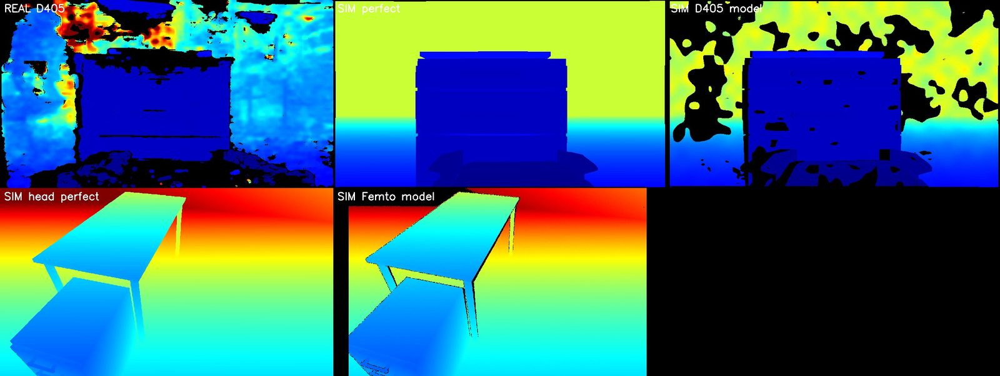
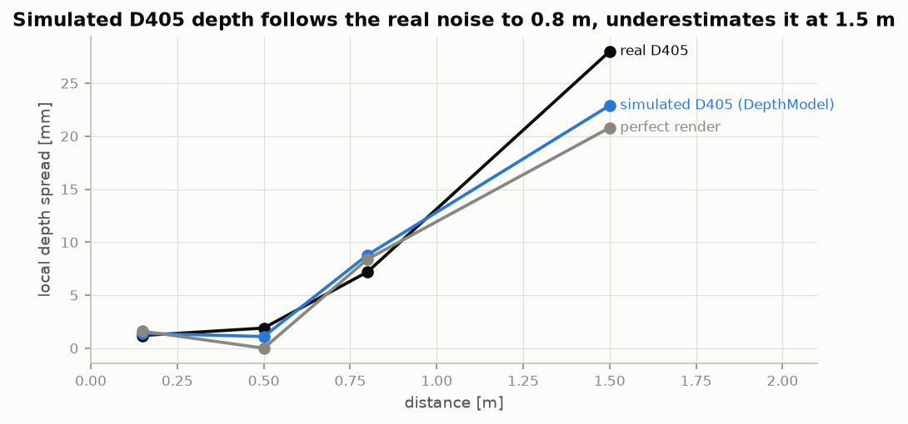

# 4. Depth sensors are not perfect

!!! abstract "In this chapter"
    - The head camera measures depth by time of flight, the wrist camera by stereo; they fail differently.
    - Stereo noise grows with the square of the distance; ToF loses dark surfaces and depth edges.
    - kcare's `find` turns a pixel into a 3-D point with this depth, so its errors are the sensor's.

## The idea

A rendered depth image is exact. Real ones are not:

| | Femto Bolt (head, time of flight) | D405 (wrist, passive stereo) |
|---|---|---|
| noise | small, \( a + b z \) | \( \sigma_z = z^2 \sigma_d / (f B) \): grows fast with distance |
| holes | dark surfaces, outside the depth camera's field of view, parallax shadow after registration to colour | texture-less surfaces, far range, occlusion band beside edges, closer than 7 cm |
| edges | "flying pixels" between foreground and background | foreground fattened by the matching window |

The spread includes the slope of the surfaces in view, which is why even the perfect render is
not zero at 0.8 m; the gap between the lines is the noise. Up to 0.8 m the model follows the real
sensor; at 1.5 m it underestimates it (23 vs 28 mm).

!!! code "Where in the code"
    `DepthModel` in [`camera_model.py`](https://github.com/mtbui2010/kcare_sim/blob/main/sim/scripts/camera_model.py);
    [`depth_compare.py`](https://github.com/mtbui2010/kcare_sim/blob/main/sim/scripts/depth_compare.py) produced both figures.

!!! measured "Measured"
    Invalid pixels: 24 % in the real D405 frame, 28 % simulated. Femto parameters are from the
    datasheet — no real Femto depth frame has been recorded yet.

## What this means when you use it

- One real depth frame is a thin basis; record more (both cameras, the home) before trusting the
  far range.
- The VLA uses colour images only; the depth model matters for kcare's `find` and anything that
  measures in 3-D.

**Next:** [5. Demonstrations from a scripted expert →](05-expert-and-randomisation.md)
