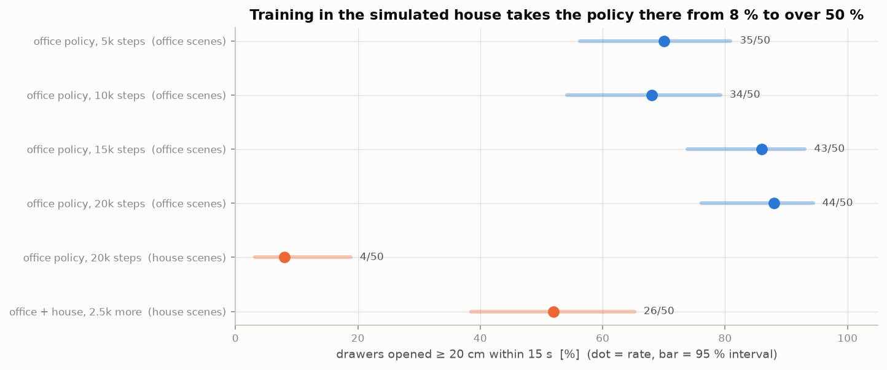

# 7. Evaluating without fooling yourself

!!! abstract "In this chapter"
    - Compare checkpoints on the same scenes: fixed seeds.
    - 50 trials leave about ±13 points of uncertainty around 50 %; plot the interval.
    - Grade with ground truth, and say that it is ground truth.

## The idea

A success rate from 50 trials is an estimate. The 95 % Wilson interval for \(k\) successes in
\(n\) trials is

\[ \frac{\hat p + \frac{z^2}{2n} \pm z\sqrt{\frac{\hat p(1-\hat p)}{n} + \frac{z^2}{4n^2}}}{1 + \frac{z^2}{n}}, \quad \hat p = k/n,\ z = 1.96 . \]

Read with the intervals: 8 % → 52 % in the house is far outside the noise; 70 % → 88 % in the
office is suggestive; 70 % vs 68 % is nothing.

!!! code "Where in the code"
    [`eval_policy.py`](https://github.com/mtbui2010/kcare_sim/blob/main/sim/scripts/eval_policy.py): `--seed0 1e9` (far from the data seeds), the
    same randomisation and camera model as the data, success = drawer ≥ 20 cm within 15 s from
    `/sim/drawer_states`. The figure: `website/tools/figures.py`.

!!! measured "Measured"
    Office policy, office scenes: 35, 34, 43, 44 of 50 at 5k, 10k, 15k, 20k steps. Same policy in
    the house: 4/50. After 2.5k steps on office + house data: 26/50.

## What this means when you use it

- Evaluate every checkpoint (`watch_eval.py`); the last one is not always the best.
- Watch failure clips (`eval_clips.py`): "opened 0 cm" can be a missed handle or the wrong drawer.
- Simulation success is an upper bound until the policy has been run on the real robot.
